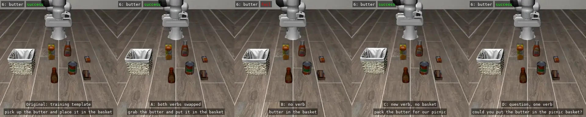

# Picnic Packing with SmolVLA

Hacktoberfest 2026 DEV Challenge, Week 1 (theme: Touch Grass).

Status: smoke test, baseline, and paraphrase experiments done. The DEV post
is next.

<p align="center">
  <b>Alphabet soup</b><br>
  
</p>

<p align="center">
  <b>Cream cheese</b><br>
  
</p>

<p align="center">
  <b>Butter</b><br>
  
</p>

<p align="center">
  <b>Orange juice</b><br>
  
</p>

Same robot, same item; only the wording changes. Left to right: the
training sentence "pick up the {item} and place it in the basket", then
four ways a person might say it instead (each tile shows the first
successful episode out of the ten episodes, or episode 0 when all 10
failed). The training
sentence works every time (40/40). Ask in your own words and the robot
packs the item only a third of the time (52/160). Among those wordings,
"{item} in the basket" and "pack the {item} for our picnic" almost never
work (2/40 each).

## Idea

Before heading out for a picnic, a person tells a robot which items to pack
from the kitchen. A vision-language-action (VLA) model, SmolVLA, reads the
camera images, the robot state, and the instruction, and outputs continuous
arm actions that pick up each item and place it in a basket. The person can
then step away from the screen and head out with the picnic.

The robot runs in simulation because there is no physical robot.

## Stack

| Layer | Choice |
| --- | --- |
| VLA model | `lerobot/smolvla_libero` (SmolVLA fine-tuned from `lerobot/smolvla_base` on `lerobot/libero`) |
| Runner | LeRobot 0.6.1. Smoke test and baseline: `lerobot-eval`, wrapped by [benchmark_eval.py](baseline/benchmark_eval.py) for inference timing. Paraphrases: [picnic_rollout.py](paraphrases/picnic_rollout.py), a rollout loop that replaces the instruction |
| Benchmark | LIBERO-Object (`libero_object`), ten tasks. Task IDs: 0 alphabet soup, 1 cream cheese, 2 salad dressing, 3 bbq sauce, 4 ketchup, 5 tomato sauce, 6 butter, 7 milk, 8 chocolate pudding, 9 orange juice |
| Simulation | robosuite on MuJoCo |
| Hardware | Laptop CPU (Intel Core Ultra X7 358H), Windows 11, WSL Ubuntu 24.04, no GPU |

## Results

### Baseline (October 9, 2026)

All ten picnic items with their original instructions, 10 episodes each:
**89 of 100 episodes succeeded**. Per-item results, the result video, and a comparison with
public results of the same checkpoint are in
[baseline/README.md](baseline/README.md), together with
the one-episode smoke test that came first.

### Paraphrased instructions (October 9–10, 2026)

Can a person ask the robot to pack an item in their own words? Four items
that scored 10/10 in the baseline were rerun with the original instruction
and four paraphrases, 10 episodes each. The original succeeds **40/40**;
the paraphrases only **52/160 (33%)**. The two wordings that drop
"put ... in the basket" almost never work (2/40 each). The instruction
variants, per-item results, result videos, and possible causes are in
[paraphrases/README.md](paraphrases/README.md).

## Known limits

- The LIBERO-Object scene places items on a floor, not a kitchen counter.
  The project frames it as a kitchen staging area.
- One item per episode. Packing several items in one episode is outside
  the training distribution.
- Producing actions is not the same as completing the task. Results record
  both separately.
- No training is planned for Week 1. `lerobot/smolvla_libero` is used for
  inference as published.
- The checkpoint was fine-tuned on all ten LIBERO-Object tasks. Evaluation
  measures whether it repeats trained tasks from new initial states, not
  whether it solves unseen tasks. Paraphrased instructions are the unseen
  part.
- CPU inference is slower than real time. See below.

### CPU inference is slower than real time

<p align="center">
  
</p>

The robot is controlled at 20 Hz, so each action covers 0.05 s. SmolVLA
predicts a chunk of 50 actions per call, and we execute the first 10 before
looking again (`n_action_steps=10`). One call therefore has to plan 0.5 s of
motion.

On this laptop CPU, one call takes 1.15 s, so a real arm would stop and go:
8.8 s of simulated motion becomes about 29.5 s, as the video shows. The
simulator waits, so success rates are unaffected. Details are in the
[smoke test](baseline/README.md#smoke-test-october-9-2026).

## Files and reproduction

Installation is in [setup.md](setup.md). Each run script activates the
Week 1 environment.

| Path | Contents |
| --- | --- |
| [baseline/](baseline/) | [run_smoke_test.sh](baseline/run_smoke_test.sh), [run_baseline.sh](baseline/run_baseline.sh), [benchmark_eval.py](baseline/benchmark_eval.py), and [README.md](baseline/README.md) (results) |
| [paraphrases/](paraphrases/) | [run_paraphrases.sh](paraphrases/run_paraphrases.sh), [picnic_rollout.py](paraphrases/picnic_rollout.py), and [README.md](paraphrases/README.md) (results) |
| [tools/](tools/) | [make_grid.py](tools/make_grid.py) (episode grids) and [make_stop_and_go.py](tools/make_stop_and_go.py) (real-robot timing video) |
| [assets/](assets/) | Result videos as animated WebP, split into `smoke_test/`, `baseline/`, and `paraphrases/` |

### Local outputs

Run scripts write videos and metrics to `outputs/`, which stays out of Git
because of its size. The videos in `assets/` were made from those outputs
with:

```bash
python tools/make_grid.py m2-items --episode 0   # baseline: episode 0 of all ten items, 2x5
python tools/make_grid.py m3-row --task-id 6     # one item: original and A-D in one row
python tools/make_stop_and_go.py                 # smoke-test episode, simulation vs real-robot time
```

The MP4 results were then converted to animated WebP at full resolution,
quality 75, 20 fps.

## Plan

The project is organized as milestones M0–M4.

| Milestone | Description |
| --- | --- |
| M0. Plan | Chose the topic (packing picnic items), the model (`lerobot/smolvla_libero`), and the benchmark (LIBERO-Object), and wrote this README and [setup.md](setup.md). |
| M1. Smoke test | Installed LeRobot with SmolVLA and LIBERO in WSL and ran one ketchup episode on CPU to confirm that the model loads, produces actions, and completes the task. See [baseline/README.md](baseline/README.md#smoke-test-october-9-2026). |
| M2. Baseline | Ran all ten picnic items with their original training instructions (`pick up the {item} and place it in the basket`), 10 episodes each, to measure how well the checkpoint performs before any wording changes. See [baseline/README.md](baseline/README.md). |
| M3. Paraphrased instructions | Reworded the instruction in four ways for the four items that scored 10/10 in the baseline, to test whether a person can ask the robot to pack an item in their own words. This is the main experiment. See [paraphrases/README.md](paraphrases/README.md). |
| M4. DEV post | Writes up the project for the Hacktoberfest DEV challenge with the `#hf26challenge` tag. |
