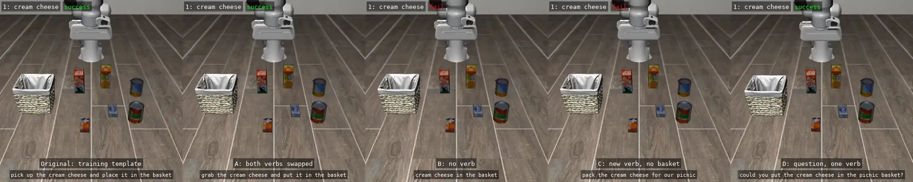
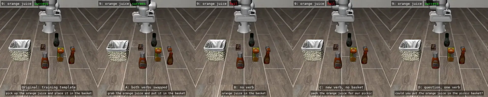
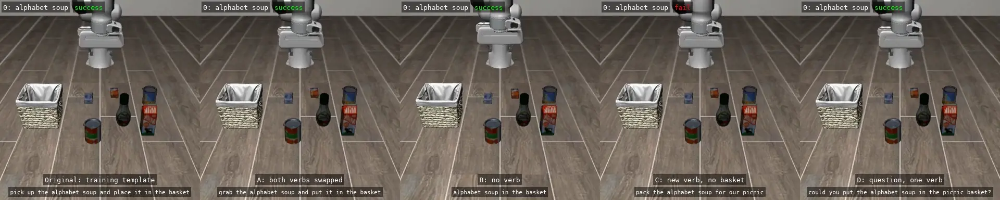

# Picnic Packing with SmolVLA

Hacktoberfest 2026 DEV Challenge, Week 1 (theme: Touch Grass).

Status: smoke test, baseline, and paraphrase experiments done. Results cleanup and the DEV post next.

## Idea

Before heading out for a picnic, a person tells a robot which items to pack
from the kitchen. A vision-language-action (VLA) model, SmolVLA, reads the
camera images, the robot state, and the instruction, and outputs continuous
arm actions that pick up each item and place it in a basket. The person can
then close the screen and head out with the picnic.

The robot runs in simulation because there is no physical robot.

## Stack

| Layer | Choice |
| --- | --- |
| VLA model | `lerobot/smolvla_libero` (SmolVLA fine-tuned from `lerobot/smolvla_base` on `lerobot/libero`) |
| Runner | LeRobot 0.6.1 (`lerobot-eval`), wrapped by [benchmark_eval.py](baseline/benchmark_eval.py) for inference timing |
| Benchmark | LIBERO-Object (`libero_object`) |
| Simulation | robosuite on MuJoCo |

## Picnic items (LIBERO-Object task IDs)

All ten tasks are "pick up the X and place it in the basket".

| ID | Item | ID | Item |
| --- | --- | --- | --- |
| 0 | alphabet soup | 5 | tomato sauce |
| 1 | cream cheese | 6 | butter |
| 2 | salad dressing | 7 | milk |
| 3 | bbq sauce | 8 | chocolate pudding |
| 4 | ketchup | 9 | orange juice |

## Known limits

- The LIBERO-Object scene places items on a floor, not a kitchen counter.
  The project frames it as a kitchen staging area.
- One item per episode. Packing several items in one episode is outside
  the training distribution.
- Producing actions is not the same as completing the task. Results record
  both separately.
- No training is planned for Week 1. `lerobot/smolvla_libero` is used for
  inference as published.
- The checkpoint was fine-tuned on all ten LIBERO-Object tasks. Evaluation
  measures whether it repeats trained tasks from new initial states, not
  whether it solves unseen tasks. Paraphrased instructions are the unseen
  part.
- CPU inference is slower than real time. See below.

### CPU inference is slower than real time

The robot is controlled at 20 Hz, so each action covers 0.05 s. SmolVLA
predicts a chunk of 50 actions per call, and we execute the first 10 before
looking again (`n_action_steps=10`). One call therefore has to plan 0.5 s of
motion.

On this laptop CPU, one call takes 1.15 s when the machine is otherwise idle
(smoke test) and 1.81 s median, 2.17 s mean during the long baseline run.

```text
Simulation (time pauses while the model thinks):
  [think 1.15 s][move 0.5 s][think 1.15 s][move 0.5 s] ...
  The simulator waits, so success rates are unaffected.

Real robot (time keeps going):
  [think 1.15 s][move 0.5 s][think 1.15 s][move 0.5 s] ...
   arm stopped              arm stopped
```

On a real arm, the robot would either stop for about 1.15 s after every
0.5 s of motion, moving only about 30% of the time (0.5 / 1.65 s), or keep
going while the next plan is computed from an image that is already more
than a second old. Either way, the motion would be stop-and-go or late to
react, and the 10-step plan would need to be about 2.3 times faster to keep
up.

Ways to close the gap, none tested here:

- Run inference on a GPU or an optimized runtime such as OpenVINO.
- Compute the next chunk while the current one executes (asynchronous
  inference, described in the SmolVLA paper).
- Execute more of each chunk per call. This trades accuracy for speed:
  running all 50 steps costs about 20 points on LIBERO
  ([huggingface/lerobot#4614](https://github.com/huggingface/lerobot/issues/4614)).

In simulation the delay does not change the results, so all success rates
in this project are valid regardless of speed.

## Results

### Smoke test (October 9, 2026)

Setup: WSL Ubuntu 24.04 on an Intel Core Ultra X7 358H laptop, CPU only,
`--policy.n_action_steps=10`, seed 1000. Command and options are in
[setup.md](setup.md).

| Task | Episodes | Success | Env steps | Episode time |
| --- | --- | --- | --- | --- |
| Ketchup (ID 4) | 1 | 1/1 | 176 of max 280 | 37.7 s |

The saved video was checked by eye: the arm places the ketchup in the basket.
One episode with a fixed seed confirms the pipeline works. It is not a
success rate.

Inference timing from `inference_timing.json`:

| Metric | Value |
| --- | --- |
| SmolVLA calls (one per 10-action chunk) | 18 |
| Time per call, mean (p90) | 1.15 s (1.25 s) |
| Total inference time | 20.6 s |
| Simulation, rendering, and other time in the episode | about 17 s |
| Whole run including model loading | 52.8 s |

On this CPU, one call takes 1.15 s to plan 10 actions, which cover 0.5 s at
the 20 Hz control rate. Inference is about 2.3 times slower than real time,
which is fine in simulation but would not drive a real robot smoothly.

The first run also downloaded about 3.3 GB (SmolVLM2 backbone, SmolVLA
checkpoint, LIBERO assets). Later runs work offline.

### Baseline: picnic item success rates (October 9, 2026)

Same setup as the smoke test. All ten LIBERO-Object tasks, 10 episodes each (initial
states 0–9, seeds 1000–1009), original instructions, one `lerobot-eval` run
via [benchmark_eval.py](baseline/benchmark_eval.py) from 15:43 to 17:08 local time.

All 100 episodes (10 items x 10 episodes). Episodes 0–9 use initial
states 0–9; `O` is a success, `.` a failure.

| ID | Item | Episodes 0–9 | Success |
| --- | --- | --- | --- |
| 0 | alphabet soup | `OOOOOOOOOO` | 10/10 |
| 1 | cream cheese | `OOOOOOOOOO` | 10/10 |
| 2 | salad dressing | `OO.OOOOOOO` | 9/10 |
| 3 | bbq sauce | `OO.OO.O..O` | 6/10 |
| 4 | ketchup | `OOOO..OOOO` | 8/10 |
| 5 | tomato sauce | `OOO.O.OOOO` | 8/10 |
| 6 | butter | `OOOOOOOOOO` | 10/10 |
| 7 | milk | `OO.OOOOOOO` | 9/10 |
| 8 | chocolate pudding | `OO.OOOOOOO` | 9/10 |
| 9 | orange juice | `OOOOOOOOOO` | 10/10 |
| | **Total** | | **89/100** |

With 10 episodes per item, only large gaps are meaningful. BBQ sauce (6/10)
looks weaker than the 10/10 items, but 8/10 and 9/10 cannot be ranked
against each other. Episode 2 accounts for 4 of the 11 failures (salad
dressing, bbq sauce, milk, chocolate pudding), so that initial state may be
harder, but 10 items are too few to confirm it.

Episode 0 of every item, played at the 20 Hz control rate. The scene layout
differs between items, while the 10 episodes of one item only shift objects
by a few centimeters. Each label shows the task ID from the table above and
the item name:


For reference, [huggingface/lerobot#4614](https://github.com/huggingface/lerobot/issues/4614)
reports 42/50 (84%) on `libero_object` for this checkpoint with
`n_action_steps=10`.

Inference timing from `inference_timing.json`:

| Metric | Value |
| --- | --- |
| Env steps / SmolVLA calls | 15,220 / 1,563 |
| Time per call, mean / median / p90 | 2.17 s / 1.81 s / 2.94 s |
| Slowest call | 59.5 s |
| Total inference time | 3,392 s (67% of the run) |
| Whole run | 5,084 s (84.7 min), 50.7 s per episode |

Calls were slower than in the smoke test (1.15 s). The laptop was also running other
desktop apps during this long run, and memory use was high (about 27 of
31 GB), so the smoke test number is the better estimate of an unloaded CPU. The
59.5 s call is an outlier, likely a system stall rather than the model.

### Paraphrased instructions (October 9–10, 2026)

Same setup as the baseline, run through [picnic_rollout.py](paraphrases/picnic_rollout.py): 4 items
x 5 instructions x 10 episodes, with the same initial states and seeds for
every instruction. The four items are the ones that succeeded 10/10 in the baseline.
The instructions are listed in [instruction variants](#instruction-variants).
Cream cheese and butter ran first via [run_paraphrases.sh](paraphrases/run_paraphrases.sh); orange juice
and alphabet soup were added the next day via [run_paraphrases_extra.sh](paraphrases/run_paraphrases_extra.sh).
Some runs were interrupted (low battery, a manual stop) and restarted by hand
with the same arguments, always from a run boundary, so every cell has
exactly 10 episodes.

| Instruction | Cream cheese | Butter | Orange juice | Alphabet soup | All |
| --- | --- | --- | --- | --- | --- |
| Original: pick up the {item} and place it in the basket | 10/10 | 10/10 | 10/10 | 10/10 | **40/40** |
| A. grab the {item} and put it in the basket | 3/10 | 10/10 | 3/10 | 6/10 | 22/40 |
| B. {item} in the basket | 0/10 | 0/10 | 0/10 | 2/10 | **2/40** |
| C. pack the {item} for our picnic | 0/10 | 2/10 | 0/10 | 0/10 | **2/40** |
| D. could you put the {item} in the picnic basket? | 3/10 | 10/10 | 6/10 | 7/10 | 26/40 |
| **All paraphrases** | 6/40 | 22/40 | 9/40 | 15/40 | **52/160** |

All 200 episodes (4 items x 5 instructions x 10 episodes, so 50 per item).
Episodes 0–9 use initial states 0–9; `O` is a success, `.` a failure:

| Instruction | Cream cheese | Butter | Orange juice | Alphabet soup |
| --- | --- | --- | --- | --- |
| Original | `OOOOOOOOOO` | `OOOOOOOOOO` | `OOOOOOOOOO` | `OOOOOOOOOO` |
| A. grab ... put | `OOO.......` | `OOOOOOOOOO` | `...OO..O..` | `OO.O.OOO..` |
| B. short | `..........` | `..........` | `..........` | `..O.O.....` |
| C. pack ... picnic | `..........` | `......OO..` | `..........` | `..........` |
| D. could you ... | `..OOO.....` | `OOOOOOOOOO` | `O.O.O.OO.O` | `OO.OOO.OO.` |
| **All 50 episodes** | **16/50** | **32/50** | **19/50** | **25/50** |

Every failure ran to the 280-step limit.

One row per item, left to right: original, A, B, C, D. Each tile shows the
first successful episode for that instruction, or episode 0 when all 10
failed.

Cream cheese:



Butter:


Orange juice:



Alphabet soup:



What the numbers show:

- The original template works for all four items (40/40, matching the baseline). Any
  rewording lowers the success rate: 52/160 (33%) across all paraphrases.
- B (no verb) and C (a new verb, no basket) almost never work: 2/40 each.
- A and D keep the "put ... in the basket" part and land in between (22/40
  and 26/40), but with large item differences. Butter is 10/10 on both;
  cream cheese is 3/10 on both. The same wording can work for one item and
  fail for another.
- With 10 episodes per cell, only large gaps are meaningful. The 2/40
  results and the butter vs cream cheese gap are large; differences of one
  or two episodes are not.

Possible causes of the failures. These are hypotheses; the runs above do
not separate them.

| Cause | Likelihood | Evidence |
| --- | --- | --- |
| One fixed sentence per task in the training data | High | Every item fails once the wording leaves the template; the model may treat the sentence as a task ID rather than as meaning |
| The language model was fine-tuned on the same 40 sentences | High | The checkpoint config has `train_expert_only: False`, so the SmolVLM2 language layers were trained too and may have lost general English |
| Small model size | Medium | The language part is about 252M parameters and uses 16 of SmolVLM2's 32 layers; a larger backbone may map "grab" or "pack" closer to "pick up" |
| Unseen words and shifted word positions | Medium | A and D keep "put ... in the basket" and succeed about half the time; B moves the item name to the start, and C, D add words such as "pack", "could you", and "picnic" that never appear in training |

Running the same instructions on a larger LIBERO checkpoint, such as
`lerobot/pi05_libero_finetuned` (about 3B parameters), would test the model
size hypothesis.

Failure modes in the videos (wrong object, no grasp, no release) are not yet
classified.

SmolVLA calls during the paraphrase runs: 4,448, mean 2.07 s per call. Total episode time
was about 217 minutes. Several episodes include time when the laptop briefly
went to sleep, so per-episode times are not reliable; step counts and
success are not affected.

## Instruction variants

Every LIBERO-Object task in the training data uses one template with only the
item name changed:

```text
pick up the {item} and place it in the basket
```

This experiment asks whether a person can hand off a picnic item in their own words. If
only the exact template works, the person stays at the screen rephrasing
instead of heading out.

### Parts of the original instruction

```text
pick up    the {item}   and   place it   in the basket
[action 1] [object]           [action 2] [destination]
```

### What each paraphrase changes

The object (item name) is kept in every paraphrase.

| Style | Instruction | Action 1 | Action 2 | Destination | Change |
| --- | --- | --- | --- | --- | --- |
| Original | pick up the {item} and place it in the basket | pick up | place | in the basket | none |
| A | grab the {item} and put it in the basket | **grab** | **put** | in the basket | both verbs swapped, structure kept |
| B | {item} in the basket | **removed** | **removed** | in the basket | no verb at all |
| C | pack the {item} for our picnic | **pack** | **removed** | **removed** | one new verb; destination replaced by a purpose ("for our picnic") |
| D | could you put the {item} in the picnic basket? | **removed** | put | in the **picnic** basket | question form ("could you"), single verb, "picnic" added |

Each paraphrase changes more than one part at once. C swaps the verb and
removes the destination together, D combines a question form, a dropped
first verb, and an added word, and A swaps both verbs. The results can show
which wordings fail, but not which single change causes the failure.

Items: cream cheese (task 1), butter (task 6), orange juice (task 9), and
alphabet soup (task 0), the four items that succeeded 10/10 with the
original instruction in the baseline. A drop with a paraphrase therefore
points to the wording, not to the grasp.

Each instruction runs for 10 episodes with the same seeds and initial states
as the baseline (4 items x 5 instructions x 10 episodes = 200 episodes). The
original instruction is rerun through [picnic_rollout.py](paraphrases/picnic_rollout.py)
as the control, so it uses the same loop as the paraphrases. Individual
episodes can differ from the baseline because `lerobot-eval` ran all tasks in
one process, so the random state at the start of each task is not the same.
Commands are in [run_paraphrases.sh](paraphrases/run_paraphrases.sh) (cream cheese, butter) and
[run_paraphrases_extra.sh](paraphrases/run_paraphrases_extra.sh) (orange juice, alphabet soup).

The paraphrases were drafted with AI assistance and reviewed by the author.
Orange juice and alphabet soup were added on October 10, after the first two
items showed that the same wording could work for butter but not for cream
cheese.

## Local outputs

Every run keeps its videos and metrics in `outputs/`, which stays out of Git
because of its size. Keep these folders for later visualization and do not
reuse a folder name for a new run, since videos with the same name are
overwritten.

| Folder | Contents | Video rate |
| --- | --- | --- |
| `outputs/smoke-ketchup*`, `outputs/rollout-check` | Smoke test and loop check | 80 fps / 20 fps |
| `outputs/m2-object` | Baseline: `videos/libero_object_{task}/eval_episode_{n}.mp4` (100), `eval_info.json`, `inference_timing.json`, item grid | 80 fps |
| `outputs/m3-paraphrase` | Paraphrased instructions: `videos/task{id}_{item}/{instruction}/ep{n}.mp4` (200), `results.jsonl` | 20 fps |
| Grid videos | Made by [make_grid.py](tools/make_grid.py): baseline grids in `outputs/m2-object/`, paraphrase grids in `outputs/m3-paraphrase/videos/` | 20 fps |
| `assets/` (in Git) | The five result videos shown in this README, as animated WebP (full resolution, quality 75) | 20 fps WebP |
| `outputs/readme-mp4s` | MP4 versions of the same five videos | 20 fps MP4 |
| `outputs/readme-gifs` | Earlier GIF versions (1280 px, 10 fps), kept in case a site does not play WebP | 10 fps GIF |

For the paraphrase runs, `{instruction}` is `original` or the instruction as a slug, for
example `videos/task6_butter/butter-in-the-basket/ep0.mp4`. The video paths
in `results.jsonl` follow this layout; `results.before-reorg.jsonl` keeps
the earlier flat paths.

[make_grid.py](tools/make_grid.py) tiles episode videos into a grid, each tile
labeled with its item or episode and its outcome. The videos in `assets/`
were made with:

```bash
python tools/make_grid.py m2-items --episode 0   # baseline: episode 0 of all ten items, 2x5
python tools/make_grid.py m3-row --task-id 6     # one item: original and A-D in one row
```

## Plan

The project is organized as milestones M0–M6.

| Milestone | Description |
| --- | --- |
| M0. Plan | Chose the topic (packing picnic items), the model (`lerobot/smolvla_libero`), and the benchmark (LIBERO-Object), and wrote this README and [setup.md](setup.md). |
| M1. Smoke test | Installed LeRobot with SmolVLA and LIBERO in WSL and ran one ketchup episode on CPU to confirm that the model loads, produces actions, and completes the task. See [Smoke test](#smoke-test-october-9-2026). |
| M2. Baseline | Ran all ten picnic items with their original training instructions, 10 episodes each, to measure how well the checkpoint performs before any wording changes. See [Baseline](#baseline-picnic-item-success-rates-october-9-2026). |
| M3. Paraphrased instructions | Reworded the instruction in four ways for the four items that scored 10/10 in the baseline, to test whether a person can hand off an item in their own words. This is the main experiment. See [Paraphrased instructions](#paraphrased-instructions-october-910-2026). |
| M4. Real picnic | Planned to pack a real picnic with the same items and record it outdoors. Dropped, so the project reports simulation results only and does not claim an outdoor test. |
| M5. Clean up | Collects the results, failure hypotheses, and result videos in this README so the runs can be understood and reproduced. |
| M6. DEV post | Writes up the project for the Hacktoberfest DEV challenge with the `#hf26challenge` tag. |
