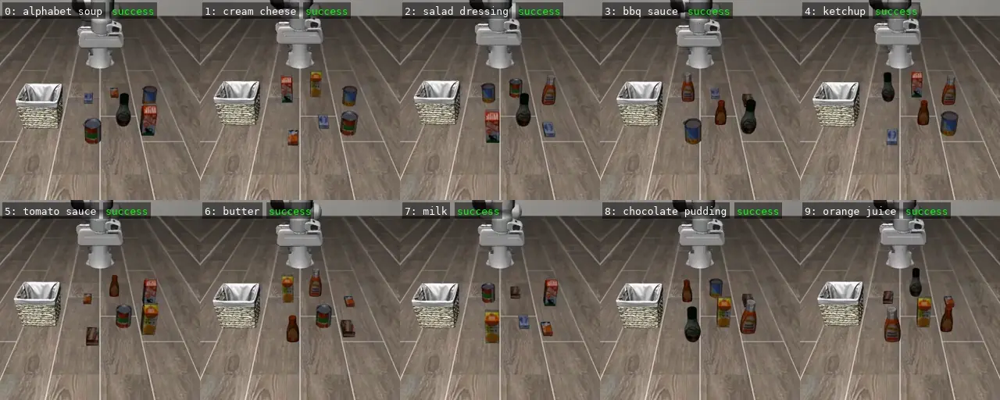
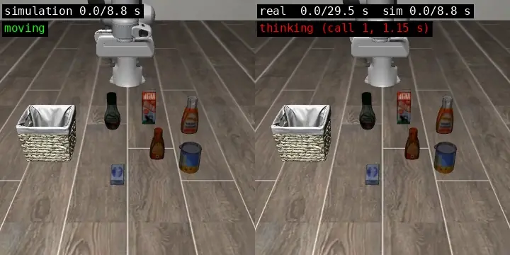

# Baseline

  

SmolVLA packing each of the ten picnic items into the basket, one episode
shown per item (labels are task IDs). Each item was tested 10 times from
slightly different starting layouts (episode) with its original training instruction
(`pick up the {item} and place it in the basket`): **89 of 100 succeeded.**
The runs use the standard LIBERO evaluation
([benchmark_eval.py](benchmark_eval.py)), so the result can be
[compared with public runs](#comparison-with-public-results) of the same
checkpoint. Everything ran on a laptop CPU (Intel Core Ultra X7 358H, WSL
Ubuntu 24.04) without a GPU.

## Results (October 9, 2026)

Same setup as the [smoke test](#smoke-test-october-9-2026). All ten LIBERO-Object tasks, 10 episodes each (initial
states 0–9, seeds 1000–1009), original instructions, one `lerobot-eval` run
via [benchmark_eval.py](benchmark_eval.py) from 15:43 to 17:08 local time.
The exact command is in [run_baseline.sh](run_baseline.sh).

Success out of 10 episodes per item (each episode starts from a different
initial state, 0–9):

| 0: alphabet soup | 1: cream cheese | 2: salad dressing | 3: bbq sauce | 4: ketchup | 5: tomato sauce | 6: butter | 7: milk | 8: chocolate pudding | 9: orange juice | **Total** |
| --- | --- | --- | --- | --- | --- | --- | --- | --- | --- | --- |
| 10/10 | 10/10 | 9/10 | 6/10 | 8/10 | 8/10 | 10/10 | 9/10 | 9/10 | 10/10 | **89/100** |

With 10 episodes per item, only large gaps are meaningful. BBQ sauce (6/10)
looks weaker than the 10/10 items, but 8/10 and 9/10 cannot be ranked
against each other. Episode 2 accounts for 4 of the 11 failures (salad
dressing, bbq sauce, milk, chocolate pudding), so that initial state may be
harder, but 10 items are too few to confirm it.

This matches a public run of the same checkpoint (84%); see
[Comparison with public results](#comparison-with-public-results).

The run took 84.7 minutes on the laptop CPU (about 51 s per episode).

## Comparison with public results

All runs below use `libero_object` tasks 0–9, seed 1000, LeRobot 0.6.1,
hf-libero 0.1.4, and robosuite 1.4.0. The public runs come from
[huggingface/lerobot#4614](https://github.com/huggingface/lerobot/issues/4614),
which changes only `n_action_steps` between paired runs.

| Run | Checkpoint | `n_action_steps` | Episodes | MuJoCo, device | Success | 95% interval |
| --- | --- | --- | --- | --- | --- | --- |
| **This project** | `lerobot/smolvla_libero` | 10 | 10 per task (100) | 3.8.1, CPU | **89/100 (89%)** | 81–94% |
| lerobot#4614 | `lerobot/smolvla_libero` | 10 | 5 per task (50) | 3.3.7, Apple MPS | 42/50 (84%) | 72–92% |
| lerobot#4614 | `lerobot/smolvla_libero` | 50 (checkpoint default) | 5 per task (50) | 3.3.7, Apple MPS | 32/50 (64%) | 50–76% |
| lerobot#4614 | `HuggingFaceVLA/smolvla_libero` | 1 (its default) | 5 per task (50) | 3.3.7, Apple MPS | 40/50 (80%) | 67–89% |

The intervals are 95% Wilson score intervals computed here from the reported
counts.

The same issue cites Table 13 of the SmolVLA paper, where executing 50 actions
per chunk averages 51.8% on LIBERO, against 82.8% for 10 and 80.3% for 1.
Those averages cover several LIBERO suites, not only `libero_object`, so they
are context rather than a direct comparison.

### What the comparison shows

- With the same checkpoint and `n_action_steps=10`, our 89% and the issue's
  84% have overlapping intervals. The difference is within what 50–100
  episodes can resolve, so the installation and settings in this project
  reproduce the public result.
- The checkpoint default of 50 actions per chunk did much worse in the
  issue (64% vs. 84%), in line with Table 13 of the SmolVLA paper. This is
  why every run in this project passes `--policy.n_action_steps=10`.

### Differences that could matter

- Hardware and backend: CPU here, Apple MPS in the issue. Small numeric
  differences can change individual episodes.
- MuJoCo version: 3.8.1 here, 3.3.7 for the issue's `libero_object` runs.
- Episodes: 10 per task with initial states 0–9 here; the issue runs 5 per
  task (its command uses `--eval.n_episodes=5` and loops over tasks 0–9), so
  with default settings it covers initial states 0–4 only. Counting only our
  episodes 0–4 gives 44/50 (88%), against the issue's 42/50 (84%).

## Smoke test (October 9, 2026)

  

The same ketchup episode on two clocks. Left: simulation time, which stops
while the model thinks (8.8 s). Right: the same run assuming a real robot
with this project's sequential loop, pausing 1.15 s before each of 18
inference calls (29.5 s). the right side is reconstructed from simulated frames ([make_stop_and_go.py](../tools/make_stop_and_go.py)).

Before the full baseline, this one ketchup episode checked that the model
loads, produces actions, and completes the task.

Setup: `--policy.n_action_steps=10`, seed 1000. The command is in
[run_smoke_test.sh](run_smoke_test.sh); installation is in
[setup.md](../setup.md).

| Task | Episodes | Success | Env steps | Episode time |
| --- | --- | --- | --- | --- |
| Ketchup (ID 4) | 1 | 1/1 | 176 of max 280 | 37.7 s |

| Metric | Value |
| --- | --- |
| SmolVLA calls (one per 10-action chunk) | 18 |
| Time per call, mean (p90) | 1.15 s (1.25 s) |
| Total inference time | 20.6 s |
| Simulation, rendering, and other time in the episode | about 17 s |
| Whole run including model loading | 52.8 s |

The first run also downloaded about 3.3 GB (SmolVLM2 backbone, SmolVLA
checkpoint, LIBERO assets). Later runs work offline.

### Limitation: CPU inference is not real time

Each call plans 0.5 s of motion but takes 1.15 s on this CPU. The simulator
waits, but a real arm would stop and go, stretching 8.8 s of motion to about
29.5 s. Real-time control would need faster inference (for example, a GPU)
and asynchronous inference; neither was tested.
