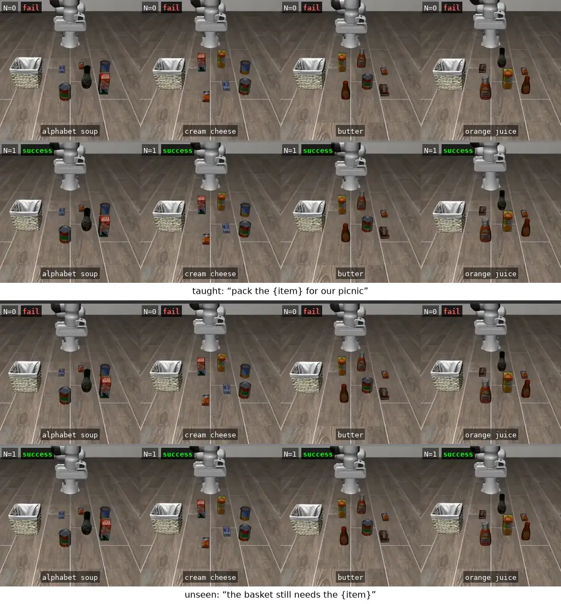
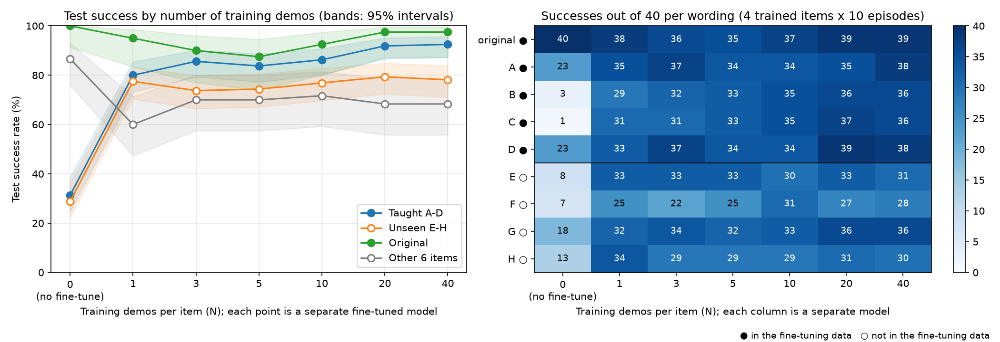
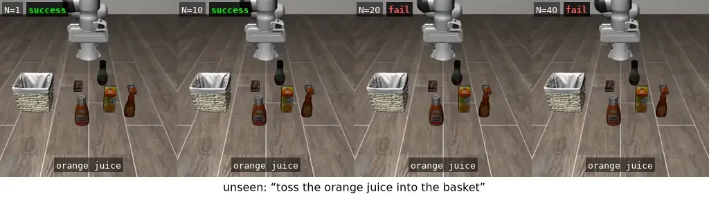
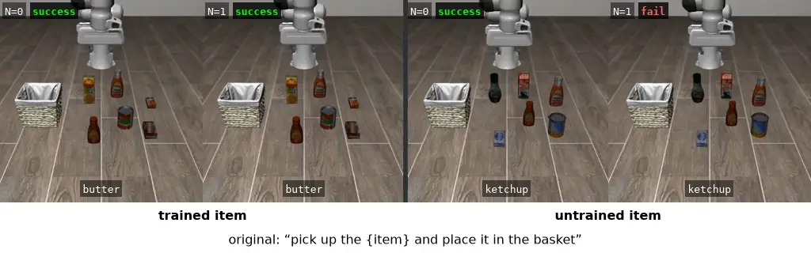
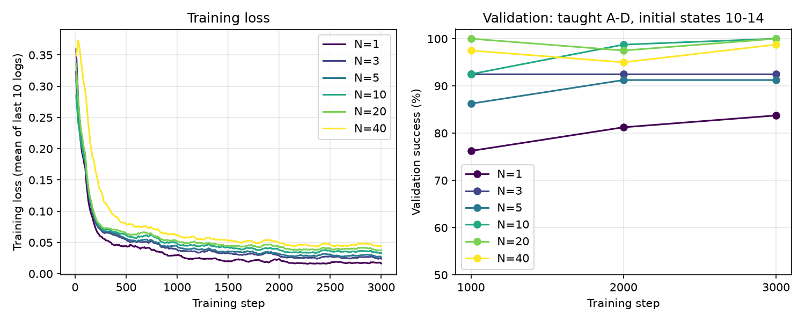

# Teaching the Picnic Robot My Words

Hacktoberfest 2026 DEV Challenge, Week 2 (theme: Side Hustle).

Status: experiment and results done (2026-10-18). The model card and the DEV
post are next.

<p align="center">
  
</p>

Each column is one picnic item. In each pair of rows, the upper clip is
`lerobot/smolvla_libero` as published (N = 0) and the lower clip is the same
model fine-tuned on one demo per item (N = 1), started from the same table.
The top pair hears "pack the {item} for our picnic", a phrasing it was
taught; the bottom pair hears "the basket still needs the {item}", a
phrasing it never saw in training. Across all 160 test episodes of each
kind, success went from 31% to 80% for the taught phrasings and from 29% to
78% for the new ones. These clips are examples; how they were chosen is in
[Files and reproduction](#files-and-reproduction).

## Idea

In Week 1, `lerobot/smolvla_libero` packed picnic items every time with its
training sentence (40/40) but only a third of the time with four other ways
of saying the same request (A to D, 52/160). Week 2 teaches the robot those
four wordings with a few demos per item and asks two questions:

1. How many demos per item does it take before the taught wordings work?
2. Does learning four wordings help with wordings it has never seen?

Side Hustle angle: the curve is a price list. "Adapting an open VLA to the
way your users talk takes N demos per item and $X of GPU time." That service
only exists because the weights are open: a closed VLA cannot be fine-tuned
on a customer's own data, inspected, or run on the customer's own hardware.

The GPU is rented by the hour, not bought: one A100 SXM 80 GB costs $1.82
per hour on RunPod (GPU and disks), and the whole experiment took about six
hours (about $11), against roughly $10,000 to $15,000 to buy one A100.

## Results

Test set: the four trained items, initial states 0 to 9, 10 episodes per
item and wording (160 episodes for the four taught wordings, 160 for the
four unseen ones, 40 for the original), plus the six other items with the
original wording (60 episodes). N is the number of demos per item used for
fine-tuning; each N is a separate model, and N = 0 is `smolvla_libero`
before fine-tuning. Every number comes from one checkpoint per N, chosen on
the validation states (taught wordings only). All tables, including results
per item and time to finish, are in [results/tables.md](results/tables.md),
generated by [tools/analyze.py](tools/analyze.py).

### One demo per item does most of the work

<p align="center">
  
</p>

Left: success rate per group of wordings. Right: the same test split by
wording, successes out of 40 (four trained items, 10 episodes each). In
both, ● marks what was in the fine-tuning data (the original sentence and
wordings A to D) and ○ what was not (wordings E to H and, on the left, the
six other items).

| Demos per item (N) | Taught A-D | Unseen E-H | Original | Other 6 items |
| --- | --- | --- | --- | --- |
| 0 | 50/160 (31%) [25-39] | 46/160 (29%) [22-36] | 40/40 (100%) [91-100] | 52/60 (87%) [76-93] |
| 1 | 128/160 (80%) [73-85] | 124/160 (78%) [70-83] | 38/40 (95%) [83-99] | 36/60 (60%) [47-71] |
| 3 | 137/160 (86%) [79-90] | 118/160 (74%) [66-80] | 36/40 (90%) [77-96] | 42/60 (70%) [57-80] |
| 5 | 134/160 (84%) [77-89] | 119/160 (74%) [67-81] | 35/40 (88%) [74-95] | 42/60 (70%) [57-80] |
| 10 | 138/160 (86%) [80-91] | 123/160 (77%) [70-83] | 37/40 (92%) [80-97] | 43/60 (72%) [59-81] |
| 20 | 147/160 (92%) [87-95] | 127/160 (79%) [72-85] | 39/40 (98%) [87-100] | 41/60 (68%) [56-79] |
| 40 | 148/160 (92%) [87-96] | 125/160 (78%) [71-84] | 39/40 (98%) [87-100] | 41/60 (68%) [56-79] |

Brackets are 95% intervals: with this many episodes, the true success rate
likely lies in that range, and ranges that do not overlap mark a clear
difference. The biggest step is from N = 0 to N = 1: four demos in total
(one per item) and about $1.50 of rented GPU time lift the taught wordings
from 31% to 80% and the unseen ones from 29% to 78%. After that, more demos
keep improving the taught wordings, up to 92% at N = 20 and 40. The robot
also gets quicker: successful episodes took 8.2 s (taught) and 9.8 s
(unseen) before fine-tuning and 7 to 8 s after, close to the original
wording.

| | Wording |
| --- | --- |
| original ● | pick up the {item} and place it in the basket |
| A ● | grab the {item} and put it in the basket |
| B ● | {item} in the basket |
| C ● | pack the {item} for our picnic |
| D ● | could you put the {item} in the picnic basket? |
| E ○ | toss the {item} into the basket |
| F ○ | the basket still needs the {item} |
| G ○ | can you get the {item} into the basket for me? |
| H ○ | move the {item} over to the basket |

● in the fine-tuning data, ○ test only. In the right chart, the two that almost never
worked before, B (3/40) and C (1/40), jumped to 29 and 31 with one demo per
item. Among the unseen ones, F, which names no action for the robot,
stays the hardest (22 to 31 of 40), and G ends the highest (36/40),
perhaps because it is a polite question like D.

### More demos did not help with new phrasings

The unseen line in the first chart stays flat: 74% to 79% for every N from
1 to 40, while the taught wordings reach 92%. The gap between taught and
unseen grows from 2 points at N = 1 to 14 at N = 40. Averaged over the four
items, new phrasings stayed flat; orange juice alone went down, from 36/40
at N = 1 to 23/40 at N = 40:

<p align="center">
  
</p>

The same scene and the same request, "toss the orange juice into the
basket", succeed at N = 1 and 10 and fail at N = 20 and 40. A likely
reason: every demo was trained with the same five sentences, so more demos
gave the robot more ways to move, not more ways to be asked. It got better
at the words it practiced, not at new ones. This comes from one training
run per N, and not every item moved this way (cream cheese improved), so
treat it as a strong hint, not a proof. If users will say things nobody
taught, collecting more phrasings looks more useful than collecting more
demos.

### The cost: the other six items get worse

<p align="center">
  
</p>

Same model, same original sentence. Butter, one of the four trained items,
still works after fine-tuning; ketchup, which the fine-tune never saw,
fails in this scene. The fine-tune only contained the four items, so the
whole model drifted toward them. Over all six other items, success fell
from 87% to 60-72% and did not recover with more demos. It is not total:
ketchup still worked in 6 to 8 of 10 scenes, and this clip shows one it
lost. The original wording on the four trained items held up (88% to 98%),
because the original sentence was part of the training mix. Mixing in a few
demos of the other items is the obvious fix to try next.

### Training length

<p align="center">
  
</p>

The loss keeps falling for all 3000 steps, but validation success (taught
wordings, initial states 10 to 14) is nearly flat from step 1000 on for
N = 3 and above, and no run ended lower than it was at step 1000. N = 1 has the lowest loss and
the lowest validation score: it memorized its four demos. With the GPU to
itself, 1000 steps take about 9 minutes (about $0.30), so for N = 3 and
above, 1000 steps would likely have been enough.

### Cost and inference time

| N | Demos (4 items) | Chosen step | Training minutes | Training cost | Seconds per call |
| --- | --- | --- | --- | --- | --- |
| 0 | 0 | - | - | - | 0.453 |
| 1 | 4 | 3000 | 48 | $1.45 | 0.445 |
| 3 | 12 | 1000 | 46 | $1.40 | 0.449 |
| 5 | 20 | 2000 | 47 | $1.43 | 0.447 |
| 10 | 40 | 3000 | 48 | $1.45 | 0.446 |
| 20 | 80 | 1000 | 49 | $1.50 | 0.337 |
| 40 | 160 | 3000 | 50 | $1.51 | 0.449 |

Training minutes are wall time while evaluation shared the GPU (about 2 s
per step instead of 0.46 s alone). The whole run, setup and about 4,400
evaluation episodes included, took about six hours and $11. One SmolVLA
call took 0.34 to 0.45 s on the shared A100 (lower when fewer evaluation
processes ran), against 1.15 s on the Week 1 laptop CPU.

## Known limits

- One training seed per N, and N = 1 uses the first demo of each item.
  Small-N results may change with other demos or seeds.
- The checkpoint per N was chosen on taught wordings only, so unseen
  wordings and other items played no part in it; a checkpoint chosen for
  them might differ.
- Wording G ("can you get the {item} into the basket for me?") shares the
  polite-question form of D, although the rules for E to H asked for a
  different sentence structure. The wordings stay as fixed before training.
- The videos are chosen examples; the rates come from the tables.
- Simulation only, as in Week 1. Fine-tuning needed about 28 GB of GPU
  memory, more than common free GPUs offer.
- Week 1 ran on CPU and Week 2 on GPU, which can flip a few episodes; N = 0
  was re-measured on the GPU (A to D 50/160 here, 52/160 in Week 1).

## Experiment

- **Start:** `lerobot/smolvla_libero`, the Week 1 checkpoint.
- **Training data:** LIBERO-Object demos from `lerobot/libero` for the four
  Week 1 items only (alphabet soup, cream cheese, butter, orange juice), the
  first N demos per item (each item has 44 or 45 demos). Each N is a
  separate fine-tune from `smolvla_libero`, and the subsets are nested
  (1 within 3 within 5, and so on up to 40). Each demo is trained with five
  instructions: the original and wordings A to D. Training on all ten items
  is left for Week 3 if needed.
  - **Runs:** N = 1, 3, 5, 10, 20, 40, all in one go, one training seed
    each. Extra seeds for N = 1 and 5 (error bars) were planned but not
    run. Run names such as `n5-s1000` mean N = 5 with training seed 1000;
    the `s` is the seed, not a training step.
- **Training length:** every N trains for the same 3000 steps, the whole
  model as in the `smolvla_libero` recipe, with the loss logged every 10
  steps. The 1000, 2000, and 3000-step checkpoints are scored on
  validation initial states 10 to 14 (wordings A to D, 80 episodes) while
  training continues, and the best one per N goes to the test. The test
  initial states 0 to 9 are never used for this choice. The validation
  scores give a success-versus-training-step curve per N, next to the loss
  curve.
- **Compared with the original `smolvla_libero` training** (from its
  `train_config.json`), 3000 steps is short but enough, because the
  starting point already does the task and the data is much smaller:

| | `smolvla_libero` training | This fine-tune |
| --- | --- | --- |
| Start | `smolvla_base` (never saw LIBERO) | `smolvla_libero` (already does the task) |
| To learn | Arm motion for 40 tasks | Four new wordings for four items |
| Data | 40 tasks, about 273,000 frames | 4 items, about 600 to 24,000 frames (N = 1 to 40) |
| Steps x batch | 25,000 x 32 | 3,000 x 32 |
| Passes over each frame | About 2.9 | About 4 (N = 40) to 160 (N = 1) |
| Learning rate | 1e-4, warmup 1,000 | 2.5e-5, warmup 200 |

- **Test wordings, 4 items (alphabet soup, cream cheese, butter, orange
  juice) x 10 episodes each, the Week 1 protocol:**

| Set | Wordings | Role |
| --- | --- | --- |
| Taught | A to D (Week 1) | Did the taught wordings get fixed? |
| Unseen | E to H in [data/wordings.json](data/wordings.json), fixed before any training under written rules (no verb or sentence structure shared with A to D); test only, never used for training or checkpoint choice | Does it generalize to new wordings? |
| Original | Training sentence | Did the robot forget what it already did? |
| Other items | Training sentence for the six untrained items (60 episodes) | Did training on four items break the other six? |

- **N = 0:** `smolvla_libero` before any training, re-measured on the GPU
  with the same test set, E to H included (Week 1 on the laptop CPU: A to
  D 52/160, original 40/40, other six items 49/60).

## Plan

| Step | Work | Status |
| --- | --- | --- |
| M0 | Rent a GPU, install LeRobot 0.6.1 with CUDA, run a smoke test there (EGL rendering) | Done: butter, original wording, success in 144 steps |
| M1 | Fix wordings E to H; build the N-demo subsets and five-instruction relabeling; pin the `lerobot/libero` revision | Done: [data/wordings.json](data/wordings.json), [data/subsets.json](data/subsets.json), [train_relabel.py](train_relabel.py) |
| M2 | Measure N = 0 on the GPU (the full test set) | Done |
| M3 | Fine-tune N = 1, 3, 5, 10, 20, 40 in one run; pick each checkpoint on the validation states | Done: chosen checkpoints in a private Hugging Face repo |
| M4 | Test the chosen checkpoints; draw the figures and the result videos | Done: [Results](#results) |
| M5 | Publish the chosen checkpoints on the Hugging Face Hub with a model card | To do |
| M6 | DEV post | To do: `devchallenge`, `hf26challenge` |

Not done: extra training seeds for N = 1 and 5.

## Stack

| Layer | Choice |
| --- | --- |
| VLA model | `lerobot/smolvla_libero`, fine-tuned per N |
| Training data | `lerobot/libero`, LIBERO-Object episodes (MP4 video) |
| Runner | LeRobot 0.6.1. Training: [run_train.sh](run_train.sh) runs [train_relabel.py](train_relabel.py), `lerobot-train` with the five-wording relabeling. Evaluation: [run_eval.py](run_eval.py) runs [rollout.py](rollout.py) (the Week 1 loop with the checkpoint, initial state, and wordings as arguments) in parallel; [watch_eval.py](watch_eval.py) validates each checkpoint during training and tests the best. [run_all.sh](run_all.sh) starts all of it in one tmux session |
| Benchmark | LIBERO-Object, same items and protocol as Week 1 |
| Hardware | One RunPod pod with 1x A100 SXM 80 GB (`NVIDIA A100-SXM4-80GB`), 16 vCPU; setup in [setup.md](setup.md) |
| Demo subsets | [data/subsets.json](data/subsets.json), built by [data/make_subsets.py](data/make_subsets.py) from `lerobot/libero` revision `a1aaacb` |

## Files and reproduction

Setup and the GPU run are in [setup.md](setup.md). The pod's evaluation
results and training logs were copied to `outputs/` (step 9 there), which
stays out of Git because of its size (2,940 test videos). The results above
were made on the laptop from those outputs:

```
python tools/analyze.py               # results/tables.md and the charts
python tools/make_grid.py items       # first video
python tools/make_grid.py trend --item "orange juice" --wording E --init 8 --ns 1 10 20 40
python tools/make_grid.py forget --item butter --other ketchup --init 6
```

[tools/make_grid.py](tools/make_grid.py) is the Week 1 grid tool adapted to Week 2. It
writes MP4 files to `outputs/grids/` and animated WebP files (quality 70,
20 fps, full resolution) to [assets/](assets/).

Scenes in the videos (LIBERO initial states):

| Video | Scenes | How they were chosen |
| --- | --- | --- |
| Four items, taught and unseen | Taught "pack the {item} for our picnic": 7 for all four items. Unseen "the basket still needs the {item}": alphabet soup 8, cream cheese 0, butter 5, orange juice 6 | Scenes where N = 0 fails and every fine-tuned model (N = 1 to 40) succeeds. For the taught wording, scene 7 is the only one that meets this for all four items; for the unseen wording, one such scene per item |
| Orange juice, N = 1 to 40 | 8 | With "toss the orange juice into the basket", N = 1 to 10 succeed and N = 20 and 40 fail |
| Butter and ketchup | 6 for both | Original wording; butter succeeds at every N, ketchup only at N = 0 |
